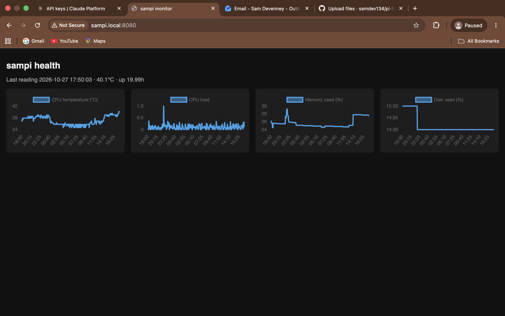

# Pi Homelab Monitor



A lightweight monitoring system running on a repurposed Raspberry Pi 1 Model B (2012), with a live dashboard, phone alerts and an AI-generated daily health report.

## Background
This Pi was previously used as an information display kiosk in a workplace. I wiped it, installed Raspberry Pi OS Lite and turned it into a home server that I manage remotely over SSH.

## Features
- **Metrics logging:** `monitor.py` runs every 5 minutes via cron and records CPU temperature, CPU load, memory use, disk use and uptime to a CSV file.
- **Web dashboard:** `index.html` charts the last 24 hours using Chart.js, served from the Pi by a systemd service, so it starts on boot and restarts if it crashes.
- **Phone alerts:** push notifications via [ntfy](https://ntfy.sh) when a metric crosses its threshold, and again when it recovers. A state file stops repeat alerts every 5 minutes.
- **AI daily report:** `summary.py` runs once a day, calculates key stats (min, max, average, peak time, restarts) and sends them to the Claude API, which writes a short plain-English health report sent to my phone.

## Design decisions
- **No extra packages:** the scripts read directly from Linux system files (`/proc/meminfo`, `/proc/uptime`, `/sys/class/thermal`) and use only Python's standard library. That keeps things light on a single-core 700MHz Pi with 512MB of RAM.
- **Charts drawn in the browser:** the Pi only serves static files, and the viewer's browser does the rendering.
- **Stats calculated before calling the AI:** sending summary stats instead of hundreds of raw readings makes requests smaller and cheaper, and means the model describes the numbers rather than calculating them.
- **Secrets kept out of git:** the API key and ntfy topic live in local files listed in `.gitignore`.

## Setup
```
git clone git@github.com:samdev134/pi-homelab-monitor.git ~/homelab-monitor
cd ~/homelab-monitor
echo "your-ntfy-topic" > ntfy_topic.txt
nano claude_key.txt   # paste your Anthropic API key
```
Add to `crontab -e`:
```
*/5 * * * * /usr/bin/python3 /home/<your-user>/homelab-monitor/monitor.py
0 9 * * * /usr/bin/python3 /home/<your-user>/homelab-monitor/summary.py
```
Install the dashboard service:
```
sudo cp homelab-dashboard.service /etc/systemd/system/
sudo systemctl daemon-reload
sudo systemctl enable --now homelab-dashboard
```
Then open `http://<pi-hostname>.local:8080`.

## Hardware
- Raspberry Pi 1 Model B
- Raspberry Pi OS Lite (32-bit)
- Wired ethernet (no Wi-Fi on this model)

## Roadmap
- [x] Log system metrics on a schedule
- [x] Web dashboard with charts
- [x] Alerts for high temperature, load, memory or disk usage
- [x] AI-generated plain-English daily health report
- [ ] Monitor other devices on the home network (up/down checks)
